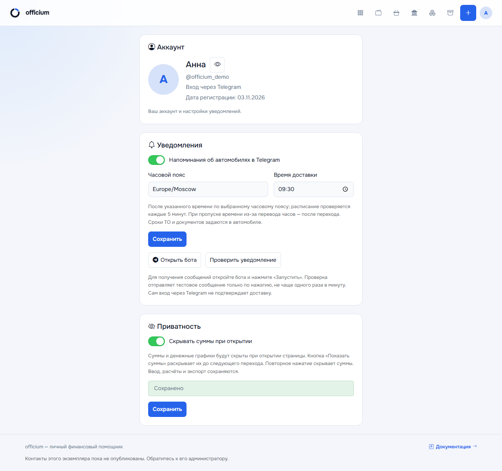
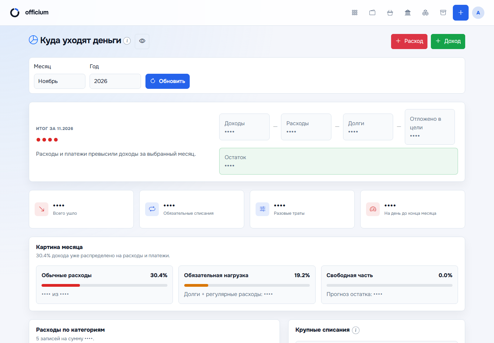
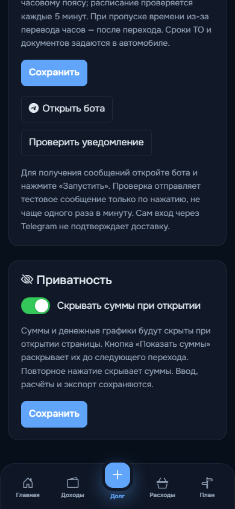

# Профиль и личные настройки

Страница `/profile` доступна после авторизации. Её открывают через аватар в
браузере и Telegram Mini App. Сохранены текущие компоненты, компактная ширина
и вертикальный порядок: «Аккаунт → Уведомления → Приватность».

## Аккаунт

Показаны аватар и имя, username при наличии, дата регистрации из `created_at`.
Аккаунт Telegram помечается «Вход через Telegram»; dev-аккаунт и аккаунт без
Telegram обрабатываются отдельно. Пустые имя/фото используют существующие
безопасные заглушки аватара. Наличие Telegram ID не подтверждает доставку.

## Сохранение

Уведомления и приватность имеют отдельные POST-формы с CSRF. Сервер изменяет
только текущего пользователя; переданный извне `user_id` не выбирает владельца.
Каждая карточка показывает «Сохранено» после коммита. Ошибка валидации или
сохранения не выдаётся за успех. Временный локальный аккаунт без записи `User`
не может сохранять личные настройки; постоянный dev-аккаунт может сохранять
приватность, но отрицательный dev Telegram ID не используется для отправки.

## Уведомления

- Флаг `vehicle_notifications_enabled` сохраняет прежний смысл и значение.
- `notification_timezone` — IANA-имя из установленной базы часовых поясов.
- `notification_delivery_time` — местное время `HH:MM`, точность до минуты.
- `NULL` в новых полях сохраняет настройки установки: `APP_TIMEZONE` и
  `VEHICLE_NOTIFICATIONS_HOUR` (по умолчанию UTC / 10:00).

Общий переключатель администратора по-прежнему управляет автоматической
отправкой. Сроки ТО и документов остаются в автомобильном модуле.
Отправщик запускается каждые 5 минут и учитывает местную дату пользователя.
Пропущенное при переводе часов время доставляется после скачка часов;
повторённое время не создаёт повторного дневного напоминания.
Резервирование уникального дневного ключа в БД предшествует вызову Telegram.
Даже неоднозначный сбой сети не запускает автоматический дубль того же сообщения.
После простоя доставка может задержаться.

## Открытие бота и тест

«Открыть бота» использует настроенный `TELEGRAM_BOT_USERNAME`; в Mini App
применяется доступный метод Telegram SDK, в браузере — обычная ссылка.
Без настроенного адреса показывается объяснение вместо неработающей ссылки.

`POST /profile/test-notification` отправляет сообщение только текущему
пользователю с положительным Telegram ID, по явному нажатию и с CSRF.
Атомарное обновление `notification_test_requested_at` резервирует одну попытку
на 60 секунд до сетевого запроса; неудачная попытка тоже учитывается.
Без токена отправка недоступна; ошибки не показывают токен и технический ответ API.
Успех означает «Telegram принял сообщение», не «подключено навсегда» и не «прочитано».
Тест не включает автоматические напоминания и не меняет их общий флаг.

## Приватность

`hide_amounts_on_open` хранится на сервере, по умолчанию `false` для новых
и существующих аккаунтов. При включении начальная HTML-разметка маскирует
денежные значения; основной контент ожидает первичного применения маски, чтобы
снизить риск краткого появления сумм. Компактная кнопка глаза без видимой надписи
расположена рядом с заголовком или действиями страницы. Подсказка и доступное
название — «Показать суммы» / «Скрыть суммы»; Tab переводит фокус, Enter
или пробел переключает отображение до следующего перехода. На дашборде
глаз находится рядом с «Деньги под контролем», в доходах — в заголовке,
в расходах — перед импортом выписки, в ипотеке — перед возвратом на дашборд.
В гараже под «Добавить автомобиль» идёт ряд: глаз → «Отчёты» → «Аналитика».
В финансовом плане и аналитике финансов глаз находится возле заголовка,
а в целях — рядом с кнопкой «Финансовый план». Возврат через
back/forward cache повторно применяет исходную настройку скрытия.

Общий механизм обрабатывает динамически добавленные суммы, денежные title/
ARIA/Bootstrap-подсказки и денежные графики. Графики скрываются целиком,
включая подписи осей и canvas-подсказки, до раскрытия. Исходные данные остаются
в браузере: это защита от случайного просмотра экрана, не шифрование и не
ограничение доступа. Поля ввода, расчёты, API и CSV не изменяются.

## Развёртывание и проверки

Если локальный `/profile` возвращает ошибку Waitress после обновления кода,
остановите старый процесс и запустите `scripts\start.bat`: он обновляет
зависимости и выполняет миграции перед запуском. Ошибка
`profile_errors is undefined` означает, что новый шаблон использует старый
обработчик Python, оставшийся в памяти; нужен перезапуск, а не удаление данных.
Отсутствующие столбцы личных настроек исправляются `flask db upgrade`.
Старые UTF-8 `.env` с BOM также поддерживаются; новый файл создаётся без BOM.

Миграция `20261122_personal_settings` добавляет безопасные значения по умолчанию.
Требуется база `tzdata` и обновлённый пяти­минутный таймер. Команды находятся
в [DEPLOYMENT.md](DEPLOYMENT.md). Реальную доставку проверяют отдельно на
настроенном боте; автоматические проверки не отправляют сообщения людям.

- `tests/test_personal_settings.py`: права, CSRF, независимое сохранение,
  ограничения теста, ошибки, расписание и DST.
- `tests/test_vehicle_notification_migration.py`: сохранность старых аккаунтов и DDL.
- `tests/e2e/profile-settings.spec.js`: браузер/Mini App, обе темы,
  клавиатура, подсказки, динамические суммы, графики и CSV.

