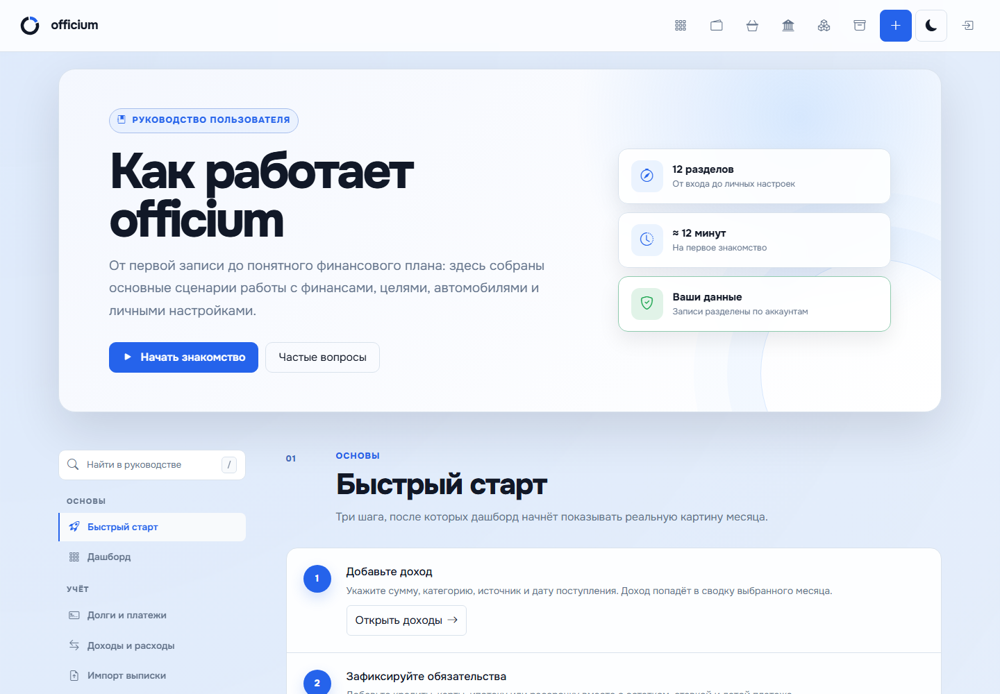

# Документация officium

Актуальное состояние: 4 ноября 2026 года. Документация текущей рабочей версии:
единый блок уведомлений, ежемесячные напоминания и Telegram через webhook или polling.
Публикация релиза и развёртывание проверяются отдельно по чек-листу выпуска.

## Пользователю

- [Release v0.0.24-alpha: напоминания, polling и прокси](releases/v0.0.24-alpha.md).
- [Release v0.0.22-alpha: профиль, документация и все изменения](releases/v0.0.22-alpha.md).
- `/documentation` — встроенное руководство с поиском, оглавлением и снимками интерфейса.
- [Полное руководство](USER_GUIDE.md).
- [Профиль, уведомления и приватность](PROFILE_SETTINGS.md).
- [Автомобили](VEHICLES_GUIDE.md).
- [Ежемесячные расходы](MONTHLY_EXPENSES_GUIDE.md).

## Разработчику и администратору

- [Развёртывание и обновление](DEPLOYMENT.md), включая
  [прокси, polling и службы напоминаний](DEPLOYMENT.md#telegram-через-прокси-polling-и-ежемесячные-напоминания).
- [План проверки](QA_TEST_PLAN.md), [чек-лист выпуска](RELEASE_CHECKLIST.md).
- [Снимки интерфейса и повторная генерация](SCREENSHOTS.md).
- [Актуальный манифест изображений](../static/images/documentation/manifest.json).
- [История изменений](../CHANGELOG.md), [безопасность](../SECURITY.md).

`qa/` содержит исторические доказательства проверок отдельных этапов, в том
числе сравнения «до/после». Они не служат иллюстрациями текущего руководства.
Текущий комплект снимков находится в `static/images/documentation/`.
