# Руководство пользователя officium

Полная интерактивная версия доступна на `/documentation`: 12 разделов,
поиск по тексту, мобильное оглавление и открытие снимков в полном размере.
Все иллюстрации созданы заново на вымышленных данных из отдельной базы.
Оглавление разделено на «Основы», «Учёт», «Планирование», «Модули»,
«Настройки», «Telegram» и «FAQ»; категории доступны также в мобильном списке.
Текущий раздел подсвечивается при прокрутке вверх и вниз по положению заголовка.
Переходы к доходам, долгам, расходам, целям, автомобилям и профилю оформлены
обычными кнопками приложения.

## 1. Вход и быстрый старт

Войдите поддерживаемым способом: Telegram или Google, если провайдер включён
на сервере. Dev-вход предназначен для локальной разработки, временный тестовый
аккаунт может не разрешать сохранение. Начните с доходов, долгов и расходов.
Обычные записи и личные настройки разделены между аккаунтами.

## 2. Дашборд

Главная показывает сводку выбранного месяца, свободные средства, обязательства
и ближайшие платежи. Переводы в накопления учитываются отдельно от расходов.
Свободные средства приложения не обязательно равны балансу банковской карты:
расчёт строится по внесённым операциям.

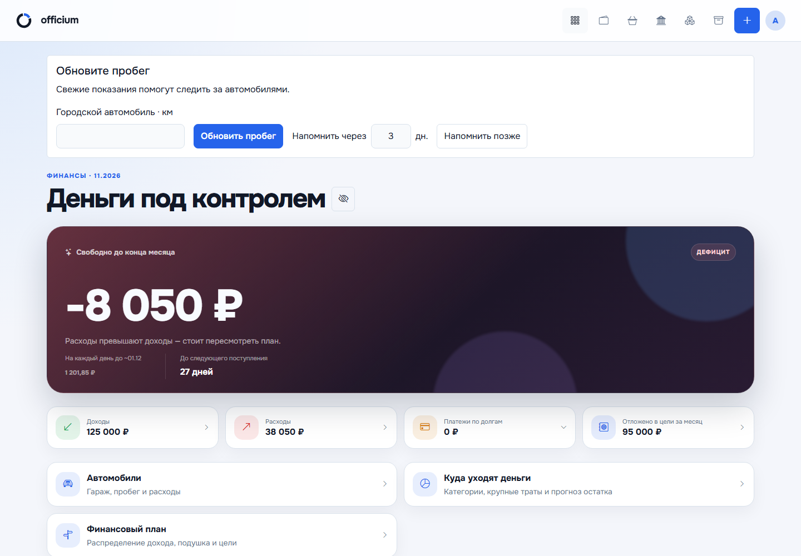

## 3. Долги и платежи

Поддерживаются кредитные карты, потребительские кредиты, ипотека и сплит.
Добавьте условия долга через «Добавить долг». В карточке доступны фактические
платежи, история и расчётный график. Проценты, комиссии и основной долг
учитываются отдельно. Сверяйте банковский остаток с данными банка.
Погашенный долг можно архивировать и восстановить.

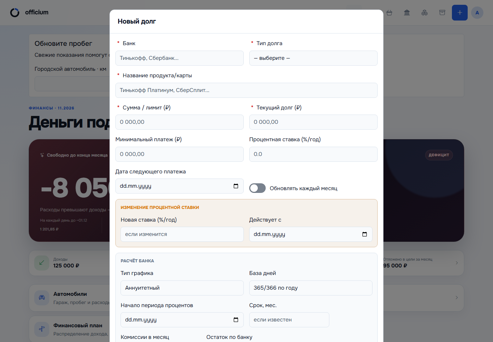

## 4. Доходы и расходы

Указывайте сумму, дату, категорию, источник дохода или название расхода.
История группируется по месяцам. Для расходов доступны способ оплаты,
комментарий и ежемесячная серия. [Правила повторения](MONTHLY_EXPENSES_GUIDE.md)
объясняют сохранение исходного дня и защиту от дублей.

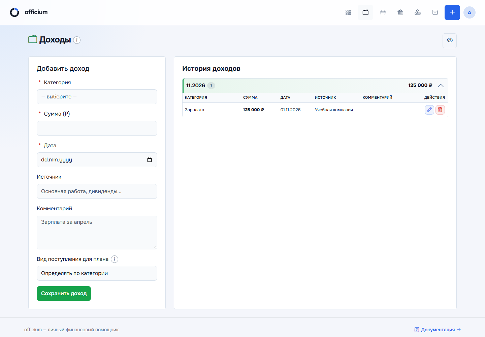
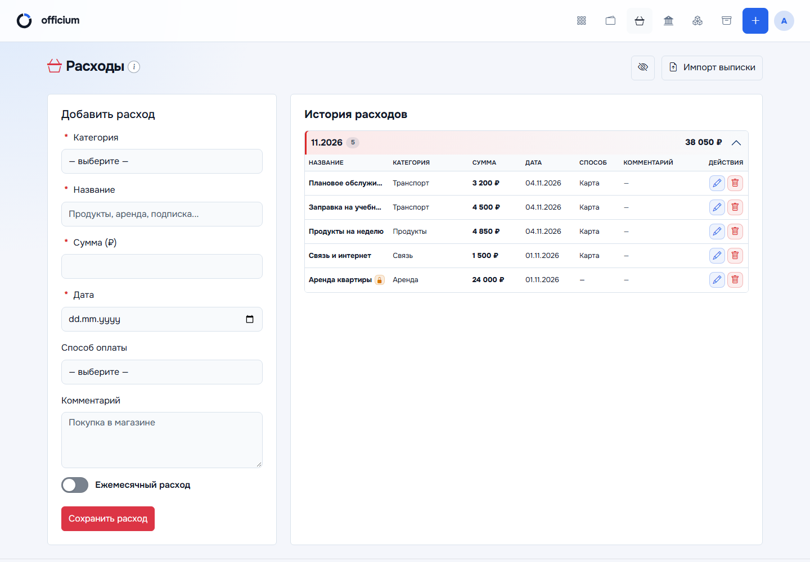

## 5. Импорт выписок

Откройте «Расходы → Импорт выписки». Поддерживаемые CSV, XLSX и текстовые PDF
обрабатываются с предварительным просмотром. Проверьте распознанные строки,
категории, способы оплаты и дубликаты. Только явное подтверждение сохраняет
выбранные расходы. Пополнения не становятся расходами.

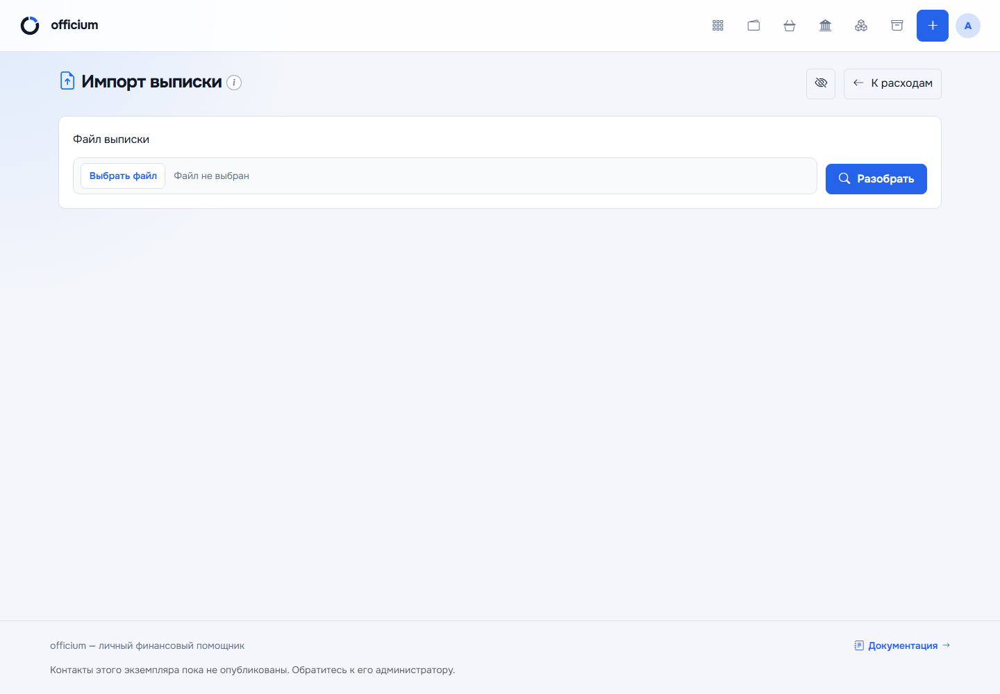

## 6. Аналитика

Раздел `/finance` показывает доходы, траты и обязательства выбранного месяца,
категории расходов и структуру нагрузки. Фильтры периода меняют рассматриваемые
данные, а не сами записи.

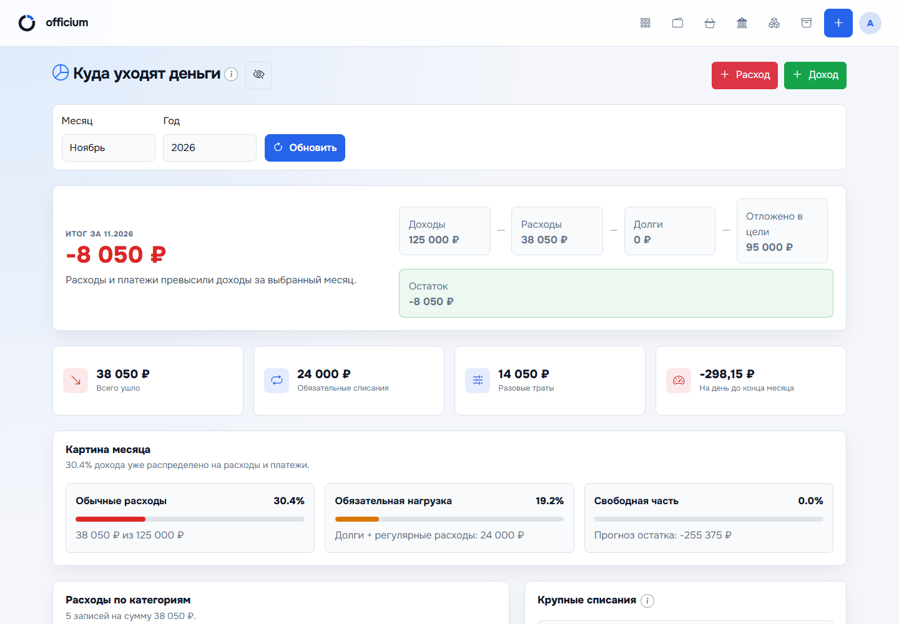

## 7. Финансовый план

План распределяет каждое поступление: обязательства, средства на жизнь,
подушка и цели. Учитываются фактические платежные даты, комиссии и уже
выполненная часть обязательств. Выберите стратегию и минимальную сумму на жизнь.
Рекомендации помогают планировать и не заменяют подтверждение операций банка.

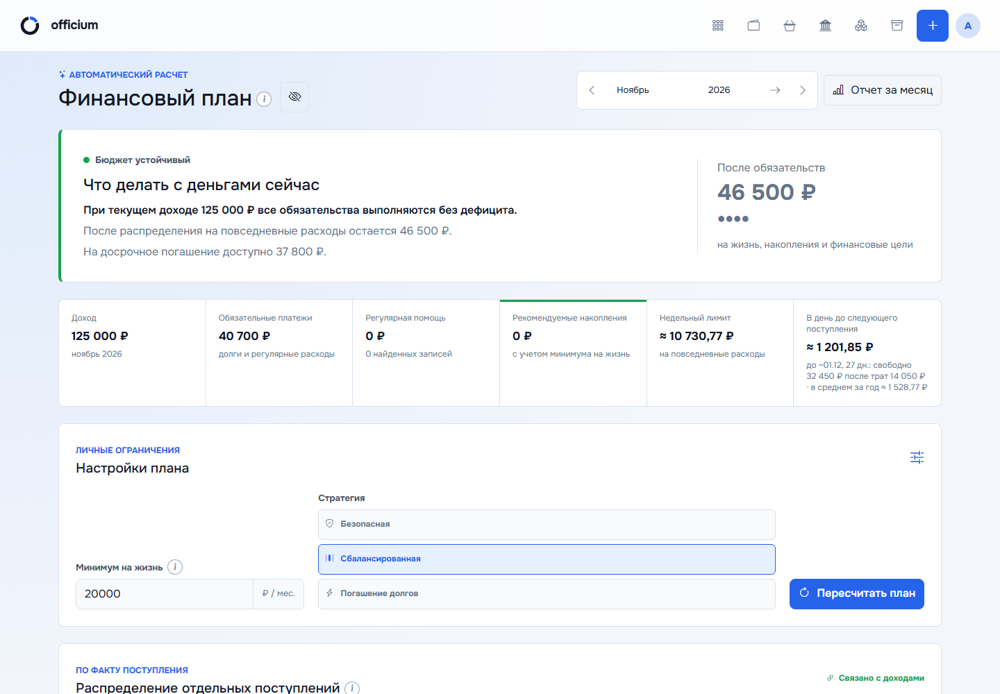

## 8. Цели и подушка

Откройте «Модули → Цели». Задайте целевую сумму, срок, взнос на месяц и
приоритет; регистрируйте пополнения и снятия. Накопления — перемещение
собственных денег. Не дублируйте тот же перевод как расход или доход.

Кнопка глаза расположена справа в заголовке, непосредственно перед
«Финансовый план». Она скрывает и раскрывает суммы без изменения данных.

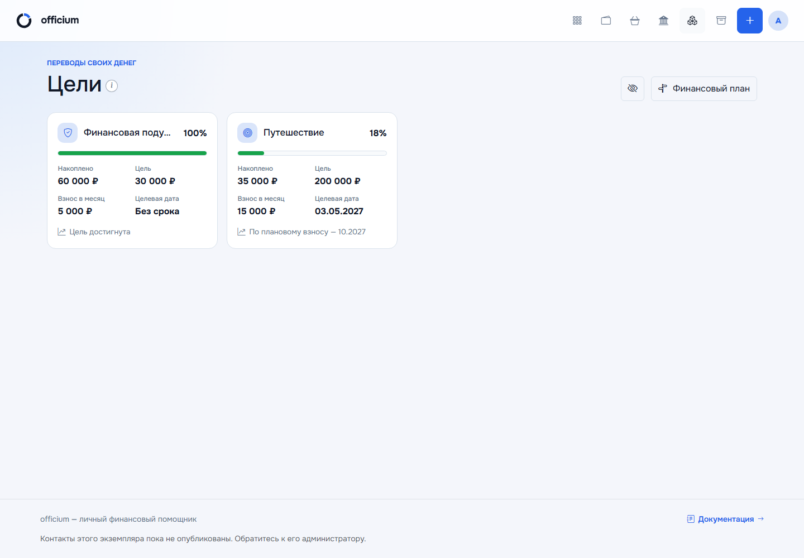

## 9. Автомобили

«Модули → Автомобили» содержит гараж, личные и организационные расходы,
показания пробега, заправки, ТО, неисправности, документы, фотографии и аналитику.
Под «Добавить автомобиль» расположены в один ряд: глаз для скрытия сумм,
«Отчёты», «Аналитика».
Подробнее: [руководство автомобильного модуля](VEHICLES_GUIDE.md).

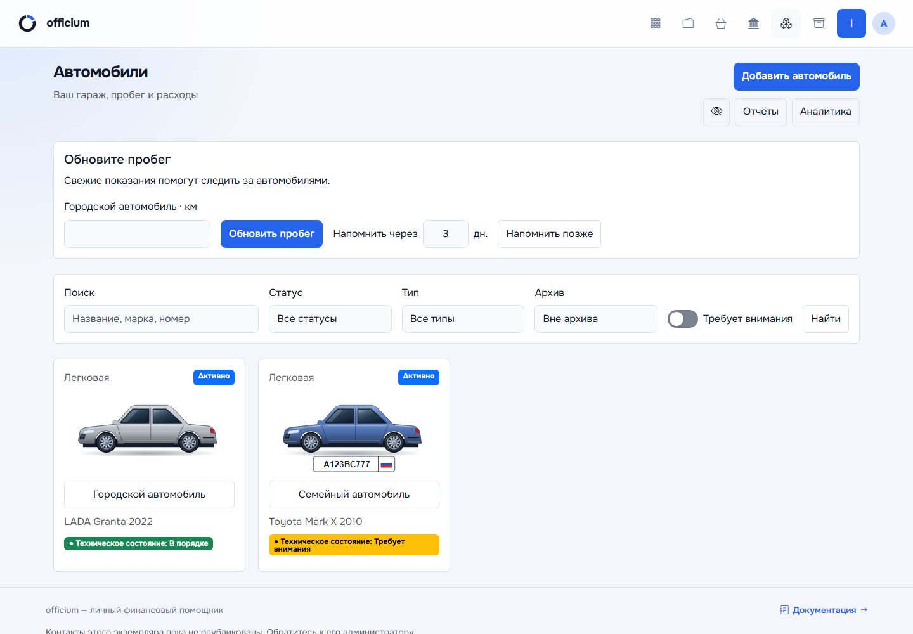

## 10. Профиль и личные настройки

Через аватар откройте `/profile`. Карточки идут в порядке «Аккаунт»,
«Уведомления», «Приватность». В одной карточке уведомлений сначала находятся
напоминания о ежемесячных расходах, затем — об автомобилях. Между ними есть
визуальный разделитель; каждый подраздел сохраняется своей кнопкой «Сохранить».

Ежемесячные напоминания по умолчанию включены: за один день, в 10:00,
Europe/Moscow. Выберите срок, местное время и часовой пояс. Одно сообщение
содержит список предстоящих расходов и итоговую сумму. Отправка возможна
в течение шести часов после выбранного времени; в коротком месяце
используется последний день вместо отсутствующего 29, 30 или 31 числа.
Автомобильные напоминания имеют отдельные время и часовой пояс.
Общая кнопка «Проверить уведомление» проверяет доставку сообщения текущему
пользователю и не включает расписания. Подробнее —
[ежемесячные расходы](MONTHLY_EXPENSES_GUIDE.md).
Суммы временно скрываются и раскрываются компактной кнопкой глаза рядом
с заголовком или действиями страницы; видимой надписи нет. Подсказка
«Показать суммы» / «Скрыть суммы» описывает следующее действие.
Кнопка работает с клавиатуры (Tab, Enter или пробел).
[Подробные правила](PROFILE_SETTINGS.md) объясняют часовые пояса, тест бота,
скрытие сумм и ограничения локального аккаунта.

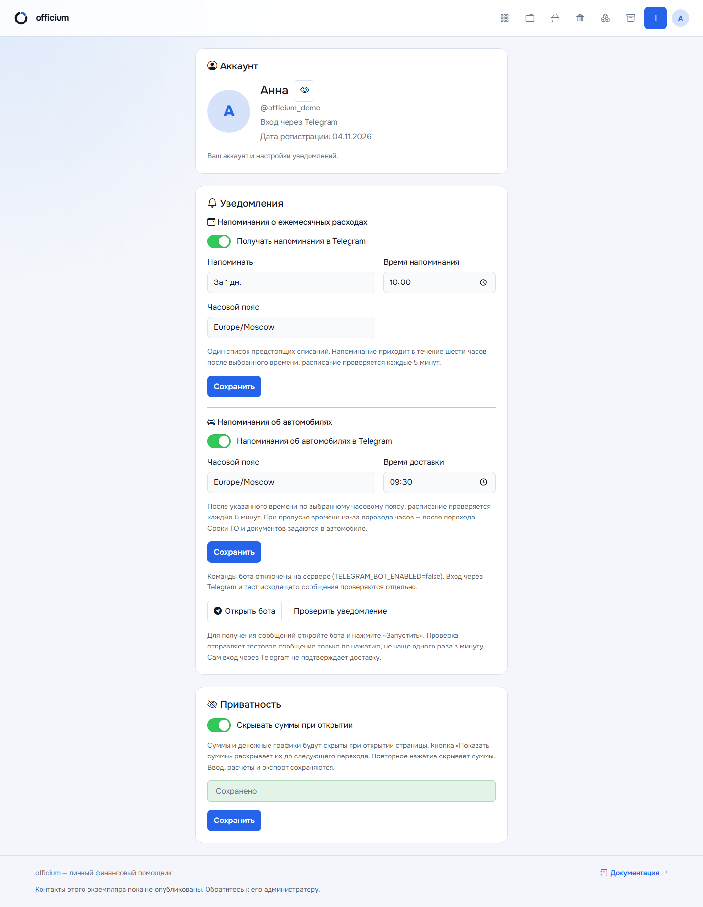

## 11. Telegram-бот и Mini App

Бот поддерживает быстрый ввод и подтверждение распознанных операций. Mini App
предоставляет интерфейс приложения внутри Telegram. В мобильном меню «Все
разделы» раскройте «Модули» для перехода к автомобилям и целям. Профиль открывается
через аватар. Анимации, адаптивная навигация и приватность работают и здесь;
системное уменьшение движения отключает анимации.

Вход, открытие Mini App и возможность доставки сообщений ботом — разные вещи.
Для уведомлений откройте бота и нажмите «Запустить», затем выполните явную
проверку в профиле. Положительный ответ API подтверждает принятие сообщения,
а не прочтение. Иллюстрация ниже — эмуляция SDK, не реальный чат.

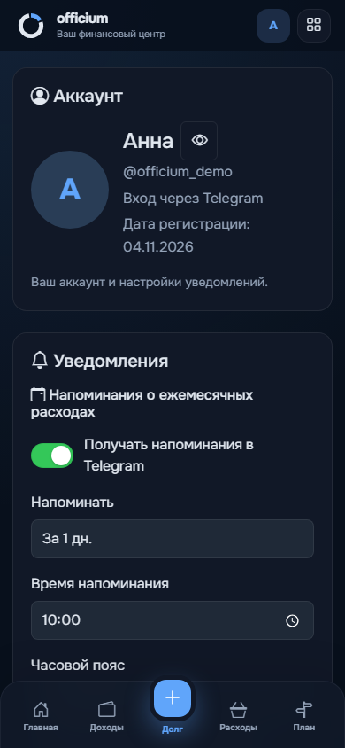

## 12. Частые вопросы

- **Почему автомобильные пункты скрылись?** На узком экране они перемещаются в «Ещё».
- **Почему нет автомобилей?** Проверьте включение модуля на сервере и вид аккаунта.
- **Почему нет уведомления?** Проверьте запуск бота, переключатель нужного вида
  напоминаний, часовой пояс и время, затем тестовую отправку; повторять её можно
  раз в минуту. Общий серверный переключатель автомобилей относится только
  к автомобильным напоминаниям. Для ежемесячных расходов также важны выбранный
  срок и шестичасовое окно доставки. После блокировки бота откройте его снова
  и повторно включите ежемесячные напоминания в профиле.
- **Что скрывает приватность?** Отображение сумм, подсказок и денежных графиков;
  ввод, исходные данные и экспорт не меняются.
- **Почему нет анимации?** В системе может быть включено уменьшение движения.
- **Почему снимки отличаются от моих данных?** В руководстве только вымышленные примеры.

Технические условия доставки и обновления описаны в [DEPLOYMENT.md](DEPLOYMENT.md).
