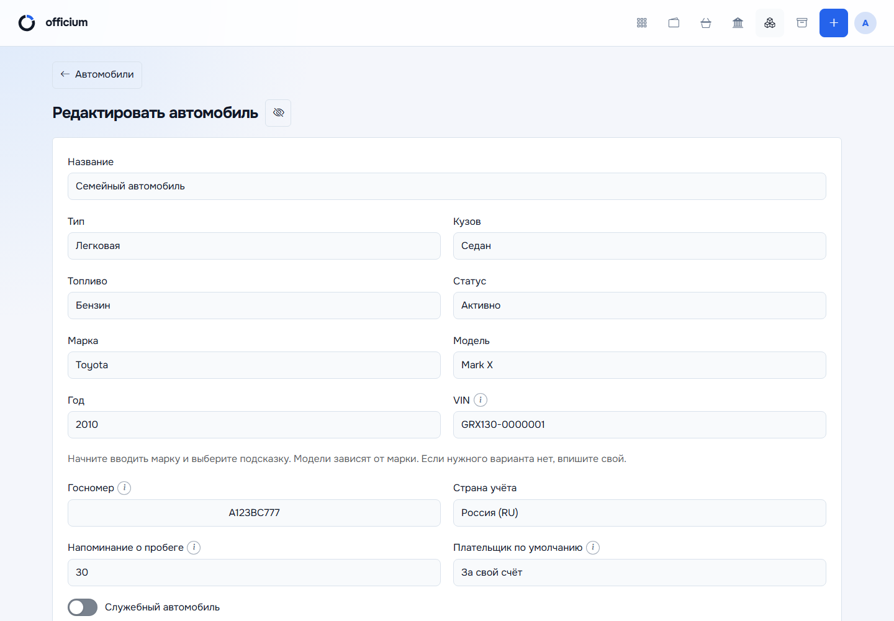
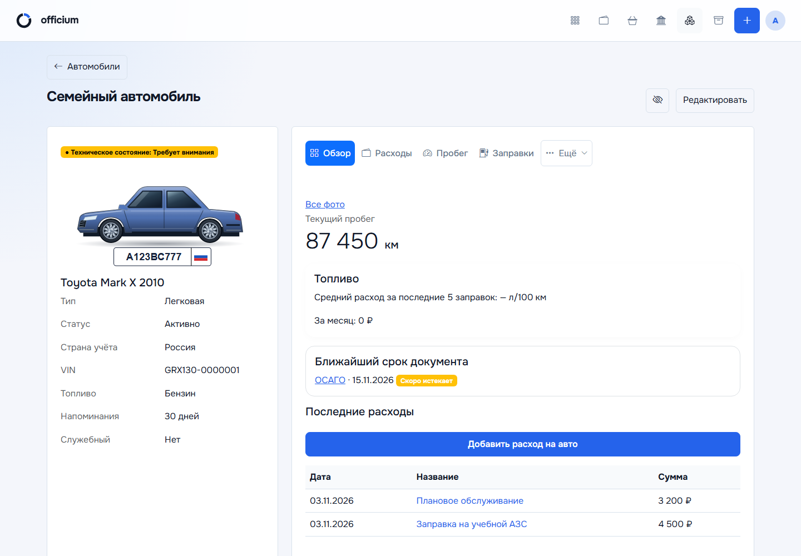
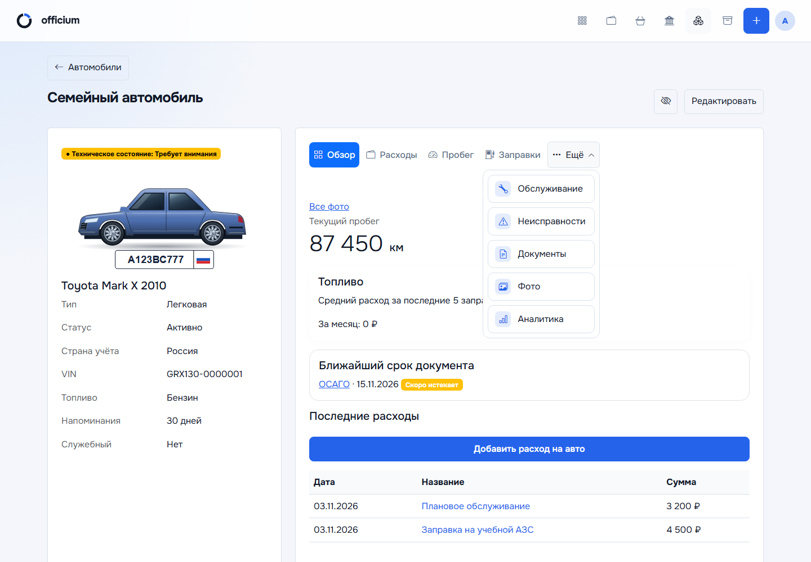
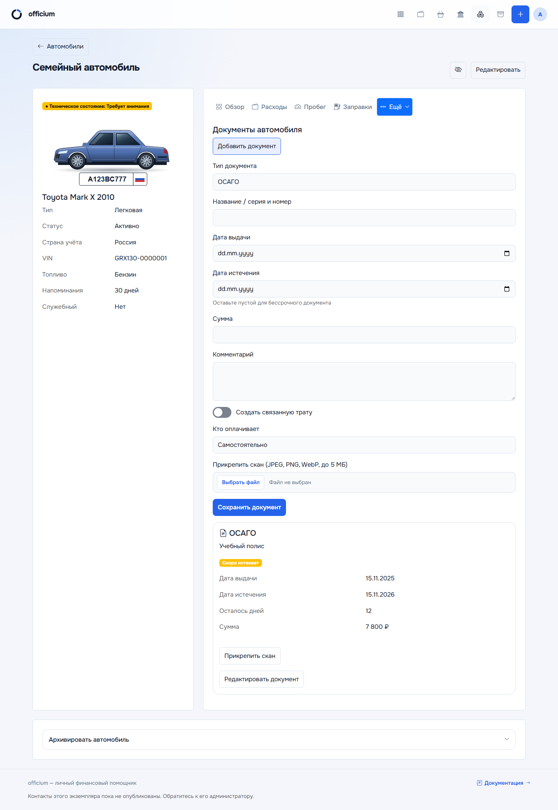

# Модуль «Автомобили»

Откройте «Модули → Автомобили». В Telegram Mini App модуль находится внутри
«Все разделы → Модули». Нужны включённый `VEHICLES_ENABLED` и постоянный
аккаунт: временный локальный режим может разрешать только просмотр.

В гараже основная кнопка «Добавить автомобиль» находится справа в заголовке.
Под ней в одной строке: глаз (скрыть/показать суммы) → «Отчёты» → «Аналитика».
Глаз отображается без надписи, с доступным названием и подсказкой.

## Гараж и добавление

Фильтры: поиск по названию/марке/номеру, статус, тип, архив и «Требует внимания».
Добавьте автомобиль, грузовик, тягач или прицеп. Заполните название, марку,
модель, год, кузов, топливо и страну учёта; задайте цвет и служебный статус.
Прицеп привязывается к собственному тягачу.

Марки подсказываются по вводу: `Toy → Toyota`. Модели связаны с маркой;
при смене марки прежняя модель очищается. Синонимы одной марки (LADA/ВАЗ)
не очищают модель. Справочник включает российский автопром, а неизвестные
марку и модель можно вписать самостоятельно.

В VIN допускаются номера кузова/шасси, например `GRX130-0000001`, до 40
латинских букв, цифр и дефисов между группами. Стандартный 17-символьный
VIN не принимает I, O, Q. Госномер проверяется по выбранной стране.
Для РФ используются форматы А123ВС77/А123ВС777, с нормализацией допустимых
латинских букв в кириллицу. Пример номера вымышленный.

## Разделы карточки

| Раздел | Назначение |
|---|---|
| Обзор | Состояние автомобиля, пробег, сводка топлива и последних расходов |
| Расходы | Свои траты, расходы организации, возмещение и отчёты |
| Пробег | Датированные показания одометра |
| Заправки | Литры, стоимость, показания пробега и расчёт расхода при наличии данных |
| Обслуживание | Интервалы ТО, выполненные работы и связанные затраты |
| Неисправности | Открытые/устранённые дефекты, важность и история |
| Документы | Тип, номер, даты, сумма, скан и связанный расход |
| Фото | Галерея и вложения автомобиля |
| Аналитика | Категории/периоды расходов, стоимость километра, сравнение и CSV |

На широком экране видны первые четыре пункта и «Ещё». Остальные пять
находятся в выпадающем меню. При сужении окна основные пункты перемещаются
туда без переноса строки. Активный раздел и «Ещё» выделены. Меню закрывается
после выбора, снаружи и по Escape; поддерживается клавиатура.
У прицепов нет пробега и заправок.

## Расходы и документы

Свои расходы участвуют в личных финансах, расходы организации учитываются
отдельно. Поле плательщика организации доступно для служебного автомобиля.
Не дублируйте связанную трату второй ручной записью.

Для документа задайте тип, название/номер, даты и сумму. Пустая дата окончания
означает бессрочный документ. «Создать связанную трату» добавляет финансовую
запись по выбранному плательщику. При изменении суммы связанного документа
укажите, обновлять ли сумму уже созданной траты. Сканы JPEG/PNG/WebP — до 5 МБ.

## Напоминания и архив

Плашка «Обновите пробег» позволяет ввести свежие показания либо отложить
напоминание на выбранное число дней. Интервал автомобиля задаётся в карточке;
0 выключает напоминание об обновлении пробега.

Часовой пояс, время доставки и общий личный флаг находятся в
[профиле](PROFILE_SETTINGS.md). Сроки ТО и документов остаются в машине.
Доставка требует запущенного бота и включённого общего флага на сервере.

Для продажи/списания раскройте «Архивировать автомобиль», выберите компактный
пункт причины и при необходимости примечание, затем подтвердите «В архив».
История сохраняется, архивную карточку можно восстановить. Анимации открытия
и закрытия учитывают системное уменьшение движения в браузере и Mini App.
