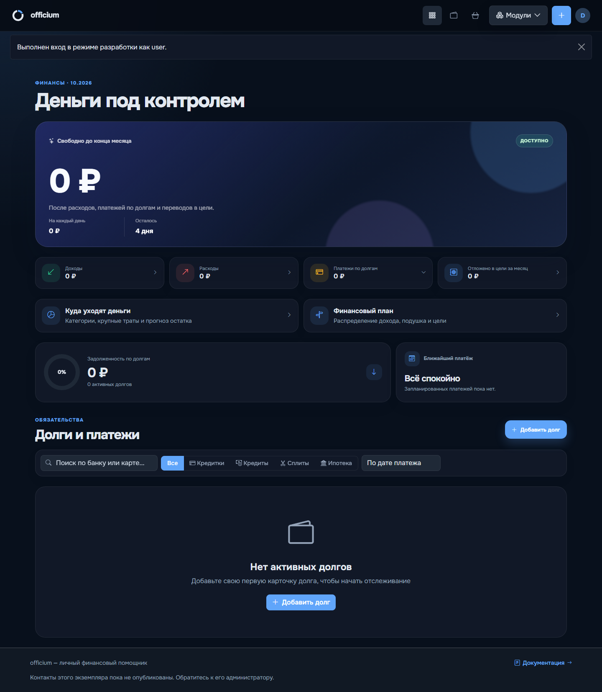

# Проверка выключенного модуля автомобилей — 28.10.2026

Проверка проведена на отдельно запущенном dev-экземпляре http://127.0.0.1:5002 с `VEHICLES_ENABLED=false`. Использованы отдельная SQLite-база, отдельная cookie сессии и вымышленные данные. В базе действительно существуют автомобиль id=1 и организационная трата id=1, поэтому 404 не объясняется отсутствием записей.

Проверены реальные страницы и HTTP-ответы через браузерный сценарий, без подмены ответов сервера:

- На дашборде нет ссылок на автомобили, в открытом меню «Модули» отсутствует пункт «Автомобили».
- В обычной форме расходов даже с `vehicle_id=1` нет выбора автомобиля.
- Все 24 запроса ниже возвращают 404. POST-запросы отправлены с действительными CSRF-токенами, без отключения защиты.
- Административные маршруты проверены под суперадминистратором, остальные — под владельцем существующих вымышленных записей.
- Основная dev-версия http://127.0.0.1:5000/vehicles/3?tab=expenses продолжает возвращать HTTP 200; её флаг и данные не менялись.

| Роль | Метод | Маршрут | HTTP |
| --- | --- | --- | --- |
| user | GET | `/vehicles` | 404 |
| user | GET | `/vehicles/new` | 404 |
| user | GET | `/vehicles/1` | 404 |
| user | GET | `/vehicles/1?tab=expenses` | 404 |
| user | GET | `/vehicles/1?tab=mileage` | 404 |
| user | GET | `/vehicles/1/edit` | 404 |
| user | GET | `/vehicles/1/expense` | 404 |
| user | GET | `/vehicles/1/spend` | 404 |
| user | GET | `/vehicles/reports` | 404 |
| user | GET | `/vehicles/reports?format=csv` | 404 |
| user | GET | `/vehicles/reports?unpaid=1` | 404 |
| user | GET | `/vehicles/costs/1` | 404 |
| user | POST | `/vehicles/new` | 404 |
| user | POST | `/vehicles/1/edit` | 404 |
| user | POST | `/vehicles/1/archive` | 404 |
| user | POST | `/vehicles/1/restore` | 404 |
| user | POST | `/vehicles/1/odometer` | 404 |
| user | POST | `/vehicles/mileage` | 404 |
| user | POST | `/vehicles/1/spend` | 404 |
| user | POST | `/vehicles/costs/1/driver-payment` | 404 |
| user | POST | `/vehicles/costs/1/reimburse` | 404 |
| superadmin | GET | `/admin/registration-countries` | 404 |
| superadmin | POST | `/admin/registration-countries` | 404 |
| superadmin | POST | `/admin/registration-countries/1` | 404 |

