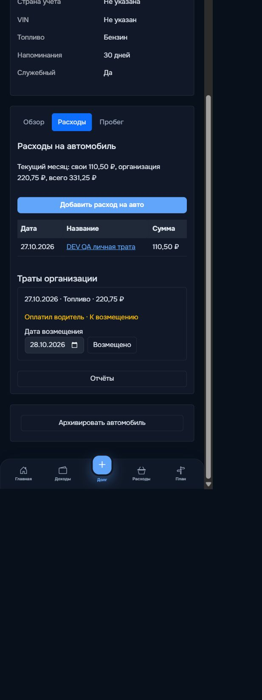

# Ручная проверка этапа 2 в dev-режиме — 28.10.2026

Проверка выполнена через интерфейс запущенного приложения http://127.0.0.1:5000, через dev-вход user. Это отдельная проверка браузером, не повторный запуск Playwright-спека.

Для сценария создан служебный автомобиль «DEV QA — вымышленный автомобиль 28.10». Данные вымышлены: личная трата 110,50 ₽ и трата организации 220,75 ₽ от 27.10.2026. Существующие записи пользователя не изменялись.

## Подтверждено через интерфейс

- Создание служебного автомобиля и личной траты через обычную форму, категория «Транспорт».
- Создание траты с плательщиком «Организация». Личная месячная сумма увеличилась только на 110,50 ₽; организационная трата в общей истории расходов отсутствует.
- В отчёте выбранного автомобиля: свои 110,50 ₽, организация 220,75 ₽, всего 331,25 ₽.
- В карточке автомобиля месячные итоги и ссылка «Отчёты» доступны во вкладке «Расходы»; ссылка расположена под тратами организации.
- Для траты без первоначальной отметки водителя работает кнопка «Оплатил водитель, к возмещению».
- Кнопка «Возмещено» сохраняет дату 28.10.2026. Снятие отметки возвращает состояние «К возмещению» и кнопку возмещения.
- Фильтр «Не возмещено»: одна организационная трата, сумма 220,75 ₽, свои 0 ₽.
- В календаре 27.10 обозначены оба плательщика. Клик открывает обе траты этого дня.
- Прошлый месяц (01–30.09.2026): пустой отчёт и нулевые суммы.
- Произвольный период 26–28.10.2026: обе траты, итог 331,25 ₽.
- Архивирование тестового автомобиля: режим «Только просмотр», нет кнопок добавления траты и возмещения. После восстановления действия доступны вновь.
- На мобильной ширине 390 px видны и доступны дата возмещения, кнопка «Возмещено» и расположенная ниже кнопка «Отчёты». Проверена тёмная тема. Временное изменение ширины браузера сброшено.

## Ограничения ручной проверки

- Нажатие «Скачать CSV» отправляет запрос и получает HTTP 200, что подтверждено журналом локального dev-сервера. Однако встроенный браузер не сообщил о завершении загрузки; событие скачивания истекло по тайм-ауту. Сохранение файла и открытие CSV в Excel вручную не подтверждены. Успешный автоматический CSV-сценарий предыдущего прогона не считается ручной проверкой.
- Светлая тема, настоящий Telegram Mini App, MySQL, смена владельца и отключение флага в этой ручной сессии не проверялись; ранее проверялись соответствующие автоматические сценарии в пределах их покрытия.

## Оставленные тестовые данные

Автомобиль восстановлен из архива и оставлен в dev-базе с двумя вымышленными тратами; организационная трата помечена «Оплатил водитель» и не возмещена. Удаление данных не выполнялось.

